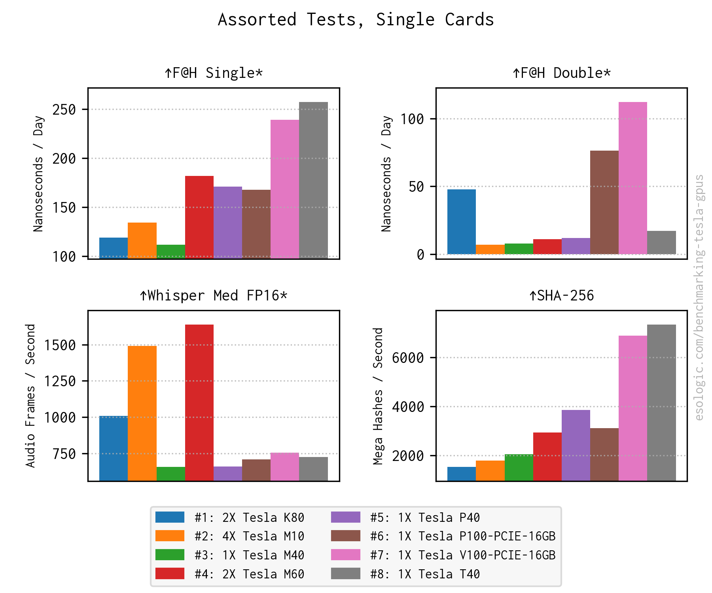

# GPU Box Benchmark


A set of benchmarks selected to compare different GPU server builds. Uses docker to force 
parallelization of normally single GPU tests.

The theory of operation for the benchmarking suite is as follows. Benchmarks are defined as 
dockerfiles and run as docker containers for compatibility and portability. The containers are run 
first on each type of GPU attached to the system. For example if there is a K80, an M10 and a 
P100 in the system, the container is run first with one of the two cores on the K80, then on one 
out of the four cores on the M10, and then once on the P100 because it only has one logical core. 
Then the container is re-run on all attached cores of all attached GPUs in parallel. Finally, if 
the test is multi-GPU native, a container is created with access to all cores of all GPUs and the 
test is run. This is an example result for a system with 3 P100's running a ResNet50 training test:

```
{
    "name": "resnet50_train_batch_64",
    "benchmark_version": "0.2.0",
    "override_parameters": {},
    "larger_better": true,
    "multi_gpu_native": true,
    "verbose_unit": "Images Processed / Second",
    "unit": "i/s",
    "critical_result_key": "native_multi_gpu_result",
    "numerical_results": {
        "min_by_gpu_type": 208.20215154739634,
        "max_by_gpu_type": 208.20215154739634,
        "mean_by_gpu_type": 208.20215154739634,
        "theoretical_multi_gpu_mean": 208.2021515473963,
        "theoretical_multi_gpu_sum": 624.606454642189,
        "forced_multi_gpu_numerical_mean": 205.4402100738262,
        "forced_multi_gpu_sum": 616.3206302214786,
        "native_multi_gpu_result": 566.5793352441259
    }
}
```

The `theoretical_multi_gpu_sum` value is numerically calculated by taking the per GPU score summed 
over all the GPUs attached to the system. In our example, if the single K80 core scored 10, this 
value would be counted twice in `theoretical_multi_gpu_sum`. If the single M10 core scored 5, this 
value would be counted four times in `theoretical_multi_gpu_sum`. The next calculated value 
`theoretical_multi_gpu_mean` is computed by `theoretical_multi_gpu_sum` and dividing it by the 
number of GPUs attached to the system. The result `forced_multi_gpu_sum` is calculated by taking 
the sum of the results from the parallel run. Similar to the other mean value, 
`forced_multi_gpu_numerical_mean` is created by dividing `forced_multi_gpu_sum` by the number of 
GPUs. All of these different figures eventually be used to identify performance bottlenecks in GPU 
boxes or the tests themselves.

Currently, only the keys defined with `critical_result_key` are used in the visualizations. 
As of writing, these are all either `native_multi_gpu_result` or `forced_multi_gpu_sum`. 
Subplots titles marked with an asterisk are `forced_multi_gpu_sum`. 

**Note:** This benchmarking suite is under active development! Use at yer own risk.

This project was introduced and contextualized on my blog, see: 
* [esologic.com/gpu-server-benchmark](https://esologic.com/gpu-server-benchmark) for the 
introduction.
* [esologic.com/benchmarking-tesla-gpus](https://esologic.com/benchmarking-tesla-gpus) for results 
from K80-T40.

Here is a sample `compare` output:



## Usage

After creating a virtual environment, it should be easy to start running the benchmarks as they're
just a series of CLIs with sensible defaults.

```
$ python bench_cli.py --help
Usage: bench_cli.py [OPTIONS] COMMAND [ARGS]...

  Uses Docker to run GPU related benchmarks with the goal of comparing system
  hardware architectures.

Options:
  --help  Show this message and exit.

Commands:
  benchmark           Run one or more benchmarks and records the results.
  compare             Draws graphs comparing benchmark outputs.
  explain-benchmarks  Prints a description about what each of the supported
                      benchmarks do.
  render-systemd      Creates a systemd unit that will execute a benchmarking
                      run at boot.
```

The `render-systemd` command exists to create a systemd unit that runs the full benchmarking suite
at boot. This is useful for working through a large number of hardware combinations because all
you have to do is start the PC to run the benchmarking suite. Output can be written anywhere
including a NAS. 

## Benchmarks

### Supported Tests

You can use the `explain-benchmarks` command to get the latest repo docs.

```
$ python bench_cli.py explain-benchmarks
Benchmark Family: resnet50, Tests: resnet50_train_batch_1 (Pretty: ResNet50 Train B=1)
resnet50_train_batch_64 (Pretty: ResNet50 Train B=64) resnet50_infer_batch_1 (Pretty: ResNet50 Infer
B=1) resnet50_infer_batch_256 (Pretty: ResNet50 Infer B=256)

From the NVidia Deep Learning Examples Repo, the ResNet50 benchmark uses the pytorch backend to run
a workload on the GPU. The benchmark uses a synthetic data backend, so it isolates raw compute and
framework performance without being limited by disk or data-loading I/O. t can be configured via
environment variables to measure either training or inference performance. 


Benchmark Family: llama_bench, Tests: llama_bench_qwen_2_5_1_5b_instruct_prompt (Pretty: llama.cpp
Qwen2.5 1.5B Prompt) llama_bench_qwen_2_5_1_5b_instruct_generation (Pretty: llama.cpp Qwen2.5 1.5B
Gen) llama_bench_meta_llama_3_8b_instruct_prompt (Pretty: llama.cpp Llama 3 8B Prompt)
llama_bench_meta_llama_3_8b_instruct_generation (Pretty: llama.cpp Llama 3 8B Gen)
llama_bench_qwen_1_5_moe_chat_prompt (Pretty: llama.cpp Qwen1.5 MoE Prompt)
llama_bench_qwen_1_5_moe_chat_generation (Pretty: llama.cpp Qwen1.5 MoE Gen)

This benchmark uses the CUDA-enabled llama.cpp container to measure large language model inference
performance on the GPU using the purpose-built llama-bench tool. The container downloads quantized
GGUF models, ranging from a small 1.5B-parameter Qwen model to a standard 8B-parameter Llama 3
model, allowing performance testing across different VRAM and compute requirements. 


Benchmark Family: blender_benchmark, Tests: blender_benchmark_monster_cpu (Pretty: Blender CPU)
blender_benchmark_monster_gpu (Pretty: Blender GPU)

This benchmark uses Blender’s official Open Data benchmark suite to measure GPU rendering
performance in a standardized, real-world workload. The workload exercises GPU compute, memory, and
driver performance Overall, this benchmark evaluates how well a GPU performs on production-style 3D
rendering tasks that closely reflect professional content-creation use cases. This is not an AI-
related benchmark. 


Benchmark Family: fah_bench, Tests: fah_bench_single (Pretty: F@H Single) fah_bench_double (Pretty:
F@H Double)

This benchmark builds and runs FAHBench, the Folding@home microbenchmark suite, to evaluate GPU
compute performance using OpenCL. The container compiles FAHBench from source with the GUI disabled,
ensuring a headless, reproducible setup suitable for automated benchmarking.The workload stresses
floating-point throughput, memory access patterns, and driver stability in a scientific computing
context rather than graphics or deep learning. Overall, this benchmark measures how well a GPU
performs on sustained, real-world molecular dynamics–style calculations similar to Folding@home
workloads. 


Benchmark Family: ai_benchmark, Tests: ai_benchmark (Pretty: AI Benchmark)

This benchmark runs the AI Benchmark suite to evaluate end-to-end deep learning performance on the
GPU using TensorFlow. Overall, it produces a single composite AI score that provides a high-level
comparison of how well a GPU performs across common deep learning tasks. 


Benchmark Family: whisper, Tests: whisper_medium_fp16 (Pretty: Whisper Med FP16)

This benchmark measures GPU-accelerated speech-to-text performance using OpenAI’s Whisper “medium”
model running on PyTorch with CUDA. At runtime, a fixed audio sample is transcribed on the GPU,
ensuring consistent input across benchmark runs. The script measures only the transcription phase
and reports throughput as mel-spectrogram frames processed per second. Overall, this test evaluates
real-world GPU inference performance for transformer-based audio models rather than synthetic or
microbenchmark workloads. 


Benchmark Family: content_aware_timelapse, Tests: content_aware_timelapse_vit_scores (Pretty: CAT
ViT Scores) content_aware_timelapse_vit_attention (Pretty: CAT ViT Attention)

Uses benchmark mode in content aware timelapse to measure throughput of a GPU or multipleGPUs
through a ViT model. Has both a fused (score) and slower unused (attention) modes. This series of
benchmarks is very relevant to the author if this repo as it is why the development is happening in
the first place. 


Benchmark Family: gdsio, Tests: gdsio_type_0 (Pretty: Storage->GPU (gdiso)) gdsio_type_2 (Pretty:
Storage->CPU->GPU (gdiso))

This benchmark uses NVIDIA’s gdsio utility to measure the raw data transfer throughput between
storage and GPU memory. By utilizing NVIDIA GPUDirect Storage (GDS) tools in compatibility mode, it
simulates the heavy I/O workload of loading large model weights from disk into VRAM or offloading
KV-caches. Overall, this test isolates the storage-to-GPU pipeline, providing a critical metric for
understanding model-load latencies and multi-GPU data orchestration performance. 


Benchmark Family: hashcat, Tests: hashcat_sha256 (Pretty: SHA-256)

This benchmark uses Hashcat’s built-in benchmark mode to measure raw cryptographic hashing
throughput on the GPU. It runs a selected fast, unsalted hash algorithm (such as SHA-256) in a tight
compute loop, providing a synthetic but highly GPU-bound workload that closely reflects the
arithmetic intensity of proof-of-work style hashing.
```

### Range of GPUs

Currently, NVidia GPUs from [Kepler](https://en.wikipedia.org/wiki/Kepler_(microarchitecture)) to
[Volta](https://en.wikipedia.org/wiki/Volta_(microarchitecture)) are known to work with this 
benchmark suite. These cards are very available and inexpensive and part of this project's aim 
is to find modern use cases for these older cards.

Because of this goal, newer GPUs may be handicapped by using CUDA, driver versions compatible with
older GPUS.

In the future, new tests will be added to get the most out of newer cards as the become more
available, but these tests will have different names to maintain compatibility. 

## Getting Started

The [NVIDIA Container Toolkit](https://docs.nvidia.com/datacenter/cloud-native/container-toolkit/latest/install-guide.html)
is used to run GPU accelerated docker containers. You'll need to install this.

That installation process also requires `nvidia-smi` which is used in this application to get
nvidia GPU info. Everything else here is managed as a python package. 

### Python Dependencies

Poetry is required to manage Python dependencies. You can install it easily by following the
operating system specific instructions [here](https://python-poetry.org/docs/#installation).

`pyproject.toml` contains dependencies for required Python modules for building, testing, and 
developing. They can all be installed in a [virtual environment](https://docs.python.org/3/library/venv.html) 
using the follow commands:

```
python3.10 -m venv .venv
source ./.venv/bin/activate
poetry install
```

There's also a bin script to do this, and will install poetry if you don't already have it:

```
./tools/create_venv.sh
```

## Developer Guide

The following is documentation for developers that would like to contribute
to GPU Box Benchmark.

### Pycharm Note

Make sure you mark `gpu_box_benchmark` and `./test` as source roots!

### Testing

This project uses pytest to manage and run unit tests. Unit tests located in the `test` directory 
are automatically run during the CI build. You can run them manually with:

```
./tools/run_tests.sh
```

### Local Linting

There are a few linters/code checks included with this project to speed up the development process:

* Black - An automatic code formatter, never think about python style again.
* Isort - Automatically organizes imports in your modules.
* Pylint - Check your code against many of the python style guide rules.
* Mypy - Check your code to make sure it is properly typed.

You can run these tools automatically in check mode, meaning you will get an error if any of them
would not pass with:

```
./tools/run_checks.sh
```

Or actually automatically apply the fixes with:

```
./tools/apply_linters.sh
```

There are also scripts in `./tools/` that include run/check for each individual tool.


### Using pre-commit

Upon cloning the repo, to use pre-commit, you'll need to install the hooks with:

```
pre-commit install --hook-type pre-commit --hook-type pre-push
```

By default:

* black
* pylint
* isort
* mypy

Are all run in apply-mode and must pass in order to actually make the commit.

Also by default, pytest needs to pass before you can push.

If you'd like skip these checks you can commit with:

```
git commit --no-verify
```

If you'd like to quickly run these pre-commit checks on all files (not just the staged ones) you
can run:

```
pre-commit run --all-files
```


